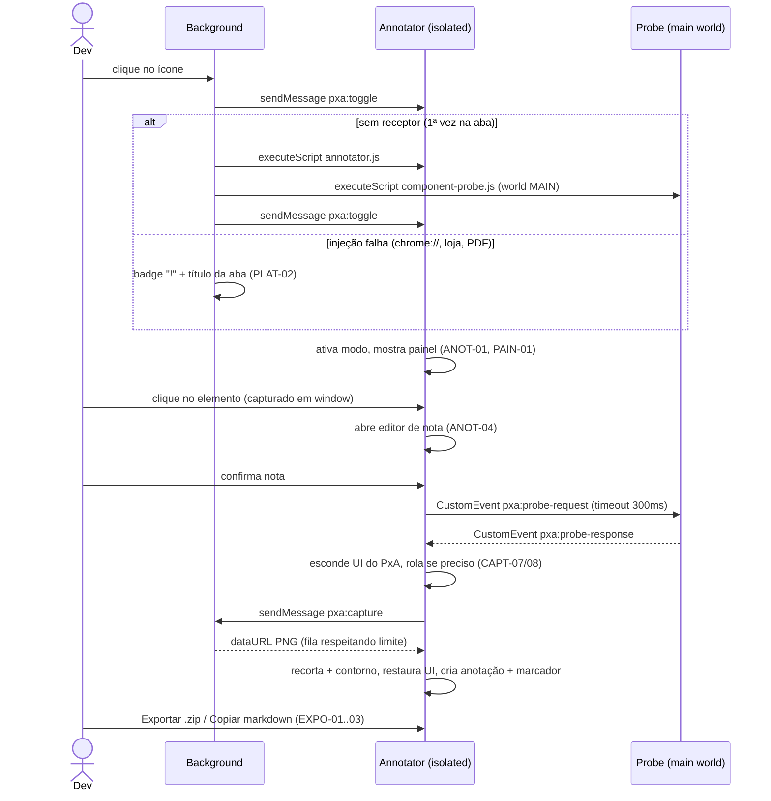

# Modo Anotação — Design

**Spec**: `.specs/features/2026-11-13-modo-anotacao/spec.md` (36 requisitos)
**Contexto**: `.specs/features/2026-11-13-modo-anotacao/context.md` (decisões travadas)
**Status**: Approved — 2026-11-13 (Sentinel, dev ausente; aprovação por seção substituída por self-review)

---

## Visão Geral da Arquitetura

Três contextos de execução, todos injetados **sob demanda** pelo clique no ícone (`activeTab` + `scripting`, sem `content_scripts` estáticos — PLAT-01, context.md):

| Contexto | Arquivo (WXT) | Responsabilidade |
|---|---|---|
| **Background** (service worker no Chrome, event page no Firefox) | `entrypoints/background.ts` | Alternar o modo / injetar scripts, badge de erro (PLAT-02), `captureVisibleTab` com fila |
| **Annotator** (content script, isolated world) | `entrypoints/annotator.content/` | Todo o estado e a UI: overlay, editor de nota, marcadores, painel, captura de contexto, recorte do print, export |
| **Component probe** (main world) | `entrypoints/component-probe.ts` | Ler internals de React/Vue que o isolated world não enxerga (COMP-01..04) |

Lógica pura (sem DOM global, testável no Vitest) fica em `lib/`.



### Abordagem escolhida e alternativas descartadas

| Tema | Escolhido | Descartado | Por quê |
|---|---|---|---|
| Onde mora o estado | Em memória no content script (por aba) | Background / `storage.session` | Decisão travada: só sessão da aba (context.md). Reload apaga, exatamente o comportamento aceito. Sem troca de mensagens a cada edição. |
| UI | DOM + CSS puro em Shadow DOM, sem framework | Preact/Svelte na UI injetada | STACK.md + CLAUDE.md: Shadow DOM e bundle pequeno. Pouca UI (painel, editor, marcadores). |
| Recorte do print | Canvas no content script | OffscreenCanvas no background | O content já sabe o retângulo, o DPR real e o nº da anotação; o background só tira a foto (Notas Técnicas da spec). |
| Ponte isolated ↔ main world | `CustomEvent` em `window` com `detail` **string JSON** + atributo temporário no elemento | `window.postMessage` com nó DOM | Nó DOM não atravessa mundos com segurança no Firefox (Xray wrappers); string JSON funciona igual nos dois. O atributo temporário é a forma de "apontar" o elemento. |
| Reposicionar marcadores | Laço `requestAnimationFrame` enquanto o modo está ativo | Só listeners de scroll/resize | Pega também mudanças de layout sem scroll (HMR, animação, conteúdo carregando). Poucas anotações → custo baixo. O mesmo laço detecta troca de `pathname` (PAIN-06). |

---

## Pesquisa de riscos de plataforma (pedido da spec)

| Risco | Resultado | Fonte | Impacto |
|---|---|---|---|
| Firefox aceita `tabs.captureVisibleTab` só com `activeTab`? | **Sim, a partir do Firefox 126** (bug 1784920). Até o 125 exigia `<all_urls>`. | MDN `activeTab_permission` e `tabs.captureVisibleTab`; Bugzilla 1784920 | Nenhum: a spec já pede Firefox ≥ 128. PLAT-01 mantém só `activeTab` + `scripting`. |
| Firefox suporta `scripting.executeScript` com `world: "MAIN"`? | Suportado a partir do Firefox 128 (mesmo piso da spec). | MDN `scripting.ExecutionWorld` — **confirmar no scaffold** | Se falhar, COMP-04 cobre: anotação sai sem componente. |
| React 19 e arquivo de origem | **Confirmado**: React 19 removeu `_debugSource` do fiber (PR #28265). Nome do componente continua disponível. | GitHub facebook/react #28265, #29092 | COMP-03 vazio no React 19 (já previsto na spec). React ≤ 18 em dev: `_debugSource.fileName/lineNumber`. |
| `beforeunload` registrado no content script dispara o aviso no Firefox? | **Não encontrei fonte conclusiva** ⚠️. MDN documenta `preventDefault()` + `returnValue`; no Firefox o isolamento é via Xray, e listeners de content script recebem eventos da janela. | MDN `beforeunload`; Bugzilla 1965975 | **Decidido (Sentinel):** fica no content script. Plano B documentado abaixo. Teste manual no Firefox fica com o dev no final. |

---

## Análise de Reuso

Projeto greenfield: não existe código. O reuso vem de bibliotecas.

| Componente | Origem | Como usar |
|---|---|---|
| WXT | npm `wxt` | Entrypoints, build Chrome/Firefox, `browser.*` unificado, `defineContentScript({ registration: 'runtime' })` e `defineUnlistedScript` para injeção sob demanda |
| fflate | npm `fflate` | `zipSync` para montar o `.zip` (EXPO-01) |
| `CSS.escape` | API nativa | Escapar ids/classes no seletor (CAPT-02) |

### Pontos de Integração

| Sistema | Integração |
|---|---|
| Página do usuário | Content script injetado; UI num único host `<pxa-root data-pxa-ignore>` com Shadow DOM |
| React / Vue da página | Leitura somente-leitura de propriedades expando no main world |
| Navegador | `action` (clique, badge, título), `scripting`, `tabs.captureVisibleTab`, `<a download>`, `navigator.clipboard` |

---

## Componentes

### Background — `entrypoints/background.ts`

- **Propósito**: alternar o modo na aba, injetar sob demanda e fotografar a aba.
- **Interface (mensagens recebidas)**:
  - `browser.action.onClicked(tab)` → `toggle(tabId)` (**atualizado no /simplify**):
    1. `scripting.executeScript({ func: () => Boolean(window.__pxaAnnotator) })` pergunta ao isolated world se o annotator já existe;
    2. se não existe: injeta em paralelo `files: ['/content-scripts/annotator.js']` e `files: ['/component-probe.js'], world: 'MAIN'` (a falha do probe é ignorada, COMP-04);
    3. envia `tabs.sendMessage(tabId, { type: 'pxa:toggle' })`;
    4. qualquer erro nos passos 1–3 → `action.setBadgeText({ tabId, text: '!' })` + `action.setTitle({ tabId, title: 'PxA não pode anotar esta página' })` (PLAT-02); em sucesso, limpa badge e título.
    - Motivo da mudança: a versão anterior decidia reinjetar pelo texto do erro do `sendMessage` ("Receiving end does not exist"), que não é API estável entre navegadores.
  - `{ type: 'pxa:capture' }` → `Promise<{ dataUrl: string }>` via `CaptureQueue`.
- **Dependências**: `lib/capture-queue.ts`.
- **Injeção única**: o annotator define `window.__pxaAnnotator` ao carregar; se já existir, não registra nada de novo (caso limite "aba já injetada"). O passo 1 já evita a reinjeção.

### CaptureQueue — `lib/capture-queue.ts`

- **Propósito**: serializar chamadas de `captureVisibleTab` respeitando o limite do Chrome (`MAX_CAPTURE_VISIBLE_TAB_CALLS_PER_SECOND` = 2), sem perder pedidos (caso limite "prints em sequência").
- **Interface**: `createCaptureQueue(capture: () => Promise<string>, minIntervalMs = 550, now?, sleep?)` → `{ enqueue(): Promise<string> }`.
- **Teste**: unit com relógio falso (FIFO, intervalo mínimo, erro de um pedido não trava a fila).

### Annotator (content) — `entrypoints/annotator.content/index.ts`

Orquestrador. Mantém a máquina de estados e conecta os módulos abaixo.

```
inactive ──toggle──▶ active ──clique──▶ editing ──confirmar──▶ capturing ──ok──▶ active
   ▲                   │                   │ Esc / vazio                        │
   └──────toggle───────┘                   └────────────▶ active ◀── erro ──────┘
```

- `inactive`: nenhum listener de interceptação; overlay, marcadores e painel ocultos; **store preservado** (ANOT-02).
- `active`: hover destaca, clique abre editor, painel visível (PAIN-01).
- `editing`: hover congelado no alvo, editor aberto junto ao elemento.
- `capturing`: UI oculta, aguardando probe + print.

### Interceptor — `annotator.content/interceptor.ts`

- **Propósito**: hover e clique sem que a página reaja (ANOT-03, ANOT-04, ANOT-07).
- **Como**: listeners em `window` com `{ capture: true }` para `pointerdown`, `pointerup`, `mousedown`, `mouseup`, `click`, `dblclick`, `contextmenu`, `touchstart` e `submit`. Se o evento **não** vem da UI do PxA (`!event.composedPath().includes(host)`): `preventDefault()` + `stopImmediatePropagation()`. Só `click` abre o editor; os outros apenas são bloqueados.
- Hover: `pointermove` em `window`, capture → `pickTarget(event)` ignora o host do PxA e elementos `data-pxa-ignore` → `Overlay.highlight(el)`.
- Instalados ao ativar, removidos ao desativar.
- **Limitação aceita**: listener da página registrado em `window`/capture **antes** da injeção ainda roda primeiro (ordem de registro). Documentado em CONCERNS.md na fase Docs.

### Overlay — `annotator.content/ui/overlay.ts`

- Contorno + rótulo `tag L×A` (ex: `button 120×40`), posicionados com `getBoundingClientRect()` numa camada `position: fixed` dentro do shadow root, `pointer-events: none` (ANOT-03).

### NoteEditor — `annotator.content/ui/note-editor.ts`

- `<textarea>` junto ao elemento (abaixo, ou acima se não couber). Enter confirma, Shift+Enter quebra linha, Esc cancela. Nota vazia ou só espaços → não cria (ANOT-06). Reusado para editar a nota no painel (PAIN-03).

### MarkerLayer — `annotator.content/ui/markers.ts`

- Um marcador pixel art numerado por anotação, no canto superior esquerdo do retângulo do elemento.
- A cada tick do laço rAF: `resolveElement(annotation)` (ver `lib/resolve.ts`) → posiciona ou oculta (ANOT-08, PAIN-06).
- P2: cor por categoria (mobile `#3fbf5f`, tablet `#f2c94c`, desktop `#4a8cff`) (MARC-01) e opacidade 0.35 quando `categoryOf(innerWidth) !== annotation.viewport.category` (MARC-02).

### Panel — `annotator.content/ui/panel.ts`

- Lista estilo quest log, fixa na lateral direita, visível sempre que o modo está ativo (PAIN-01).
- Item: `#N`, ícone da categoria (📱/📟/🖥️), `390px`, `pathname+search+hash`, primeiros 60 caracteres da nota.
- Ações por item: clicar → `scrollIntoView({ block: 'center' })` + destaque temporário; se `resolveElement` retornar `null` → aviso "elemento não encontrado nesta tela" (PAIN-02). Editar (PAIN-03). Excluir (PAIN-04, numeração não muda).
- **Recolhível** (decisão do Execute, 2026-11-13): botão ▾/▴ no cabeçalho deixa só a barra "PxA · Anotações (N)" no canto inferior direito. Ao ativar o modo com `innerWidth < 768` o painel já abre recolhido. Motivo: o E2E em 390px mostrou que o painel aberto (320px) cobria quase toda a página e impedia anotar (ANOT-04) justamente no caso mobile. Continua visível, então PAIN-01 se mantém.
- Rodapé: "Exportar .zip", "Copiar markdown", "Limpar tudo" (com `confirm` interno no painel) — desabilitados com 0 anotações (PAIN-05, EXPO-05).
- Estado vazio com instrução de uso (PAIN-05).

### AnnotationStore — `lib/store.ts`

- **Propósito**: estado em memória das anotações da aba.
- **Interface**:
  - `add(draft): Annotation` — atribui `number = nextNumber++` (nunca reutiliza; PAIN-04)
  - `updateNote(id, note)` (PAIN-03) · `remove(id)` (PAIN-04) · `clear()` (EXPO-05) · `list()` (ordem de criação)
  - `markExported()` / `isDirty()` — dirty = há criação/edição depois do último `.zip` (AVIS-01); "copiar markdown" não chama `markExported`
  - `subscribe(listener)` para UI re-renderizar
- Referência ao nó: `WeakRef<Element>` guardada fora do objeto serializável (map `id → WeakRef`).

### ContextCapture — `annotator.content/capture.ts` (+ funções puras em `lib/`)

Executa no momento da **confirmação** da nota (CAPT-07), nesta ordem:

1. `lib/selector.ts` → seletor único (CAPT-02).
2. `lib/viewport.ts` → `{ width: innerWidth, height: innerHeight, breakpoint, category, dpr: devicePixelRatio, orientation }` (CAPT-03).
3. Retângulo + `scrollX/scrollY` (CAPT-04).
4. `lib/outer-html.ts` → `outerHTML` truncado em 2.000 chars + flag (CAPT-05).
5. `lib/css-filter.ts` + `defaultStyleFor(tag)` → CSS relevante (CAPT-06).
6. `ProbeClient.probe(el)` em paralelo com 7 (COMP-01..04).
7. `ScreenshotService.shoot(el)` (CAPT-07/08).

### Seletor — `lib/selector.ts`

- **Interface**: `buildSelector(el: Element, root: Document | ParentNode = document): string`.
- **Algoritmo** (CAPT-02 + caso limite de id duplicado/classe gerada):
  1. Se `el.id` é estável (não bate com `isGeneratedToken`) e `#id` é único → retorna.
  2. Senão, sobe do elemento à raiz montando segmentos. Cada segmento: `tag` + atributo de teste estável se houver (`data-testid`, `data-test`, `data-cy`, `data-qa`, `name`) + até 2 classes estáveis. Após cada segmento, testa `querySelectorAll(path).length === 1` → para.
  3. Se não ficou único, adiciona `:nth-of-type(n)` nos segmentos, de baixo para cima, até ficar único.
  4. Garantia final: `querySelectorAll(result)` retorna exatamente `[el]`; se não, cai no caminho completo `tag:nth-of-type()` desde `html`.
- `isGeneratedToken`: heurística para hashes de CSS-in-JS/CSS modules (ex: `css-1a2b3c`, `sc-AxjAm`, `jsx-123`, `Button_root__x7Yz2`, tokens com ≥ 5 caracteres alfanuméricos mistos sem vogal-padrão). Lista de padrões fica no próprio módulo, coberta por teste.
- Tudo com `CSS.escape`.

### Viewport — `lib/viewport.ts`

- `breakpointOf(width)`: `base` <640, `sm` ≥640, `md` ≥768, `lg` ≥1024, `xl` ≥1280, `2xl` ≥1536.
- `categoryOf(width)`: `mobile` <768, `tablet` 768–1023, `desktop` ≥1024.
- `orientationOf(w, h)`: `retrato` se `h >= w`, senão `paisagem`.

### CSS relevante — `lib/css-filter.ts`

Lista fixa (CAPT-06), em ordem de saída:

- **Layout**: `display`, `position`, `top`, `right`, `bottom`, `left`, `z-index`, `float`, `overflow-x`, `overflow-y`
- **Flex/Grid**: `flex-direction`, `flex-wrap`, `justify-content`, `align-items`, `align-self`, `align-content`, `gap`, `row-gap`, `column-gap`, `flex-grow`, `flex-shrink`, `flex-basis`, `order`, `grid-template-columns`, `grid-template-rows`, `grid-column`, `grid-row`
- **Box model**: `box-sizing`, `width`, `height`, `min-width`, `max-width`, `min-height`, `max-height`, `margin-top/right/bottom/left`, `padding-top/right/bottom/left`, `border-top/right/bottom/left-width`, `border-top/right/bottom/left-style`, `border-top/right/bottom/left-color`, `border-radius`
- **Tipografia**: `font-family`, `font-size`, `font-weight`, `line-height`, `letter-spacing`, `text-align`, `text-transform`, `white-space`
- **Cor e efeitos**: `color`, `background-color`, `background-image`, `opacity`, `box-shadow`, `transform`, `visibility`

- **Interface pura**: `filterCss(computed: Record<string,string>, defaults: Record<string,string>): Array<[prop, value]>` — remove propriedades iguais ao default da tag; **sempre mantém** `display`, `width`, `height`.
- **Defaults da tag** (`annotator.content/default-style.ts`): `<iframe srcdoc="">` oculto **dentro do shadow root** (não herda CSS da página), cria `document.createElement(tag)` lá, lê `getComputedStyle`, cacheia por tag. Iframe criado sob demanda e reaproveitado.
- **Compactação na saída**: `margin`/`padding`/`border-*` com 4 lados iguais viram shorthand no markdown (`lib/markdown.ts`).

### ProbeClient (isolated) — `annotator.content/probe-client.ts` · Probe (main) — `entrypoints/component-probe.ts`

- **Protocolo**:
  1. isolated: `el.setAttribute('data-pxa-probe', reqId)`; `window.dispatchEvent(new CustomEvent('pxa:probe-request', { detail: JSON.stringify({ reqId }) }))`.
  2. main: `document.querySelector('[data-pxa-probe="reqId"]')` → detecta → `window.dispatchEvent(new CustomEvent('pxa:probe-response', { detail: JSON.stringify({ reqId, result }) }))`.
  3. isolated: remove o atributo **sempre** (finally); timeout 300ms → `null` (COMP-04). Qualquer exceção → `null`, sem UI de erro.
- **React** (COMP-01/03): chave do elemento que começa com `__reactFiber$` (≥17) ou `__reactInternalInstance$` (≤16). Sobe por `fiber.return`; conta como componente os tags `0` (Function), `1` (Class), `11` (ForwardRef), `14`/`15` (Memo). Nome: `type.displayName ?? type.name`, `type.render?.displayName ?? type.render?.name` (forwardRef), `type.type?.displayName ?? type.type?.name` (memo). Ignora anônimos. Fonte: `fiber._debugSource?.{fileName,lineNumber}` (só React ≤ 18 em dev; React 19 → vazio).
- **Vue 3** (COMP-02/03): sobe pelo DOM até achar `__vueParentComponent`; nome `type.name ?? type.__name ?? basename(type.__file)`; arquivo `type.__file`; pais via `instance.parent`.
- **Vue 2** (COMP-02/03): sobe pelo DOM até achar `__vue__`; nome `$options.name ?? $options._componentTag`; arquivo `$options.__file`; pais via `$parent`.
- **Resultado**: `{ framework: 'react' | 'vue2' | 'vue3', name, chain: string[] /* até 5 ancestrais, do mais próximo ao mais distante */, file?: string, line?: number }`.
- Ordem de tentativa: React → Vue 3 → Vue 2.

### ScreenshotService — `annotator.content/screenshot.ts` (+ `lib/crop.ts`)

1. Se o retângulo não está todo no viewport: `el.scrollIntoView({ block: 'center', inline: 'center' })` e espera 2 frames (CAPT-08).
2. Recalcula o retângulo. Se ainda é maior que o viewport → `partial = true`.
3. Esconde a UI do PxA: `host.style.visibility = 'hidden'`, espera 2 `requestAnimationFrame` (CAPT-07).
4. `browser.runtime.sendMessage({ type: 'pxa:capture' })` → dataURL.
5. Restaura a UI (em `finally`).
6. `lib/crop.ts` (puro): `cropRect(elRect, viewport, margin = 16, scale)` → retângulo em px de imagem, interseção com a imagem. `scale = image.naturalWidth / innerWidth` (mais robusto que `devicePixelRatio` com zoom).
7. Canvas: desenha o recorte, contorno 2px CSS × scale em `#ff3e7f` sobre o elemento → `canvas.toBlob('image/png')`.

### Exporter — `lib/markdown.ts`, `lib/export-names.ts`, `annotator.content/exporter.ts`

- `renderMarkdown(annotations, meta, { imageLinks: boolean }): string` (puro, snapshot test; EXPO-02/03).
- `zipName(date)` → `pxa-feedback-YYYY-MM-DD-HHmm.zip` (hora local); `shotName(n)` → `shots/NN.png`, 3 dígitos se n ≥ 100 (EXPO-01).
- `exportZip()`: `zipSync({ 'feedback.md': utf8, 'shots/01.png': bytes, ... })` → `Blob` → `URL.createObjectURL` → `<a download>` clicado dentro do shadow root → `revokeObjectURL` após 1s → `store.markExported()` (EXPO-01, EXPO-04, AVIS-01).
- `copyMarkdown()`: `navigator.clipboard.writeText(renderMarkdown(..., { imageLinks: false }))` → toast "Markdown copiado"; erro ou API ausente → toast "Não consegui copiar. Use Exportar .zip." (EXPO-03 + caso limite).

### RouteWatcher / tick — `annotator.content/tick.ts`

- Laço rAF ativo só no estado `active`/`editing`: atualiza overlay, marcadores e detecta mudança de `location.pathname` (PAIN-06).

### UnloadGuard — `annotator.content/unload-guard.ts` (P2)

- `window.addEventListener('beforeunload', (e) => { if (store.isDirty()) { e.preventDefault(); e.returnValue = '' } })` registrado na injeção, independente do modo estar ativo (AVIS-01).

---

## Modelos de Dados

```typescript
type Breakpoint = 'base' | 'sm' | 'md' | 'lg' | 'xl' | '2xl'
type ScreenCategory = 'mobile' | 'tablet' | 'desktop'

interface ViewportInfo {
  width: number            // innerWidth
  height: number           // innerHeight
  breakpoint: Breakpoint
  category: ScreenCategory
  dpr: number
  orientation: 'retrato' | 'paisagem'
}

interface ComponentInfo {
  framework: 'react' | 'vue2' | 'vue3'
  name: string
  chain: string[]          // até 5 ancestrais, do mais próximo ao mais distante
  file?: string
  line?: number
}

interface Annotation {
  id: string               // crypto.randomUUID()
  number: number           // sequencial, nunca reutilizado
  note: string
  createdAt: string        // ISO
  updatedAt: string        // ISO
  url: string              // location.href
  path: string             // pathname + search + hash
  pathname: string         // usado na comparação de rota (PAIN-06)
  selector: string
  viewport: ViewportInfo
  rect: { x: number; y: number; width: number; height: number }
  scroll: { x: number; y: number }
  outerHtml: string
  outerHtmlTruncated: boolean
  css: Array<[property: string, value: string]>
  component: ComponentInfo | null
  shot: Blob | null        // PNG; null se o print falhou
  shotPartial: boolean
}
```

### Regra de resolução do elemento — `lib/resolve.ts`

```typescript
resolveElement(
  annotation: Pick<Annotation, 'selector' | 'pathname'>,
  ref: WeakRef<Element> | undefined,
  currentPathname: string,
  root: ParentNode,
): Element | null
// 1. ref?.deref() conectado (isConnected) → ele
// 2. pathname igual → querySelectorAll(selector); exatamente 1 → ele
// 3. senão → null (marcador oculto; painel mostra "não encontrado")
```

## Formato do `feedback.md` (EXPO-02)

````markdown
# Feedback PxA — localhost:3000

- **Gerado em:** 13/11/2026 14:32
- **Anotações:** 2
- **Para o Claude Code:** cada seção abaixo é um ajuste visual. Use o componente/arquivo e o seletor para localizar o código, a tela (categoria + largura) para saber em qual breakpoint corrigir e o print para conferir. Resolva todos.

---

## #1 · 📱 mobile · 390px (`base`) · `/dashboard?tab=2`

- **Componente:** `ClienteCard` ← `ClientesList` ← `DashboardPage` (React)
- **Arquivo:** `src/components/ClienteCard.tsx:42`
- **Seletor:** `[data-testid="cliente-card"] > div.card-footer`
- **Viewport:** 390×844 · DPR 3 · retrato
- **Print:** 

**Nota:**

```text
botões saindo pra fora do card
```

**CSS relevante:**

```css
display: flex;
width: 420px;
height: 48px;
gap: 16px;
padding: 8px;
```

**HTML** (truncado em 2.000 caracteres):

```html
<div class="card-footer">…</div>
```

---
````

Regras:
- Linha de "Componente/Arquivo" omitida quando `component === null`; "Arquivo" omitido sem `file`.
- Print parcial → sufixo ` (print parcial)`; sem print → `**Print:** indisponível`.
- "Copiar markdown" troca o link por `**Print:** (print disponível no .zip)` (EXPO-03).
- **Escape** (caso limite markdown/crases): nota, CSS e HTML vão em blocos cercados com cerca de crases de tamanho `max(3, maior sequência de crases no conteúdo + 1)`. Seletor/caminho inline usam crases com a mesma regra.
- "(truncado em 2.000 caracteres)" só aparece quando `outerHtmlTruncated`.

---

## Tratamento de Erros

| Cenário | Tratamento | O que o dev vê |
|---|---|---|
| Injeção falha (página restrita) | `catch` no background → badge + título por aba | `!` no ícone, título "PxA não pode anotar esta página" (PLAT-02) |
| Probe não responde em 300ms / exceção / sem framework | `null` | Nada; anotação sem componente (COMP-04) |
| `captureVisibleTab` rejeita | Anotação criada com `shot: null` | Toast "Print falhou" + "Print: indisponível" no export |
| Elemento removido / rota diferente | `resolveElement` → `null` | Marcador oculto; no painel "elemento não encontrado nesta tela" (PAIN-02) |
| Clipboard negado / ausente | `catch` | Toast sugerindo o `.zip` |
| Erro ao gerar o zip | `catch` | Toast "Falha ao exportar" e `markExported` **não** é chamado |
| Seletor não único após algoritmo | Fallback caminho `nth-of-type` completo | Nada |

---

## Decisões Técnicas (não óbvias)

| Decisão | Escolha | Justificativa |
|---|---|---|
| Esconder UI no print | `visibility: hidden` no host + 2 rAF | `display: none` causaria reflow da página; 2 frames garantem que a pintura saiu antes da foto |
| Escala do recorte | `naturalWidth / innerWidth` | Com zoom do navegador o `devicePixelRatio` não bate com a imagem capturada |
| Defaults de CSS por tag | Iframe vazio dentro do shadow root | Não herda CSS da página e não suja o DOM visível |
| Detalhe dos CustomEvents | String JSON | Evita Xray/structured clone entre mundos no Firefox |
| Numeração | Contador monotônico no store | PAIN-04: excluir não renumera |
| Página com CSP estrita | Sem `eval`/inline script: os 3 scripts são arquivos da extensão | `executeScript({ files })` não é bloqueado pela CSP da página |

---

## Decisões que o executor pode tomar sozinho (com default)

| Ponto aberto | Default | Quando escalar |
|---|---|---|
| Fonte pixel bitmap | Fonte com licença OFL embutida em `assets/` (ex: família pixel livre); se nenhuma servir, `monospace` | Nunca bloqueia o MVP |
| Sprites dos marcadores | CSS puro (box-shadow pixelado) com número | — |
| Firefox: `beforeunload` do content script não mostra o aviso | Mover o listener para o probe (main world), ligado/desligado por CustomEvent `pxa:dirty` | Se nem no main world funcionar → registrar em STATE.md como limitação do Firefox |
| Firefox: `world: 'MAIN'` indisponível | COMP-04 (sem componente) e registrar em CONCERNS.md | Se o dev quiser componente no Firefox |
| Posição do painel | Lateral direita, 320px. **Atualizado no Execute:** recolhível pelo botão ▾/▴ do cabeçalho; abaixo de 768px abre recolhido (barra com o contador no rodapé direito) | — |
| Atributos de teste no seletor | `data-testid`, `data-test`, `data-cy`, `data-qa`, `name` | — |

---

## Estratégia de Testes (rastreável)

| Camada | Cobre |
|---|---|
| Unit — `lib/viewport.test.ts` | CAPT-03 (fronteiras 639/640/767/768/1023/1024/1279/1280/1535/1536) |
| Unit — `lib/selector.test.ts` (happy-dom) | CAPT-02 + casos limite id duplicado / classes hash |
| Unit — `lib/css-filter.test.ts` | CAPT-06 |
| Unit — `lib/outer-html.test.ts` | CAPT-05 |
| Unit — `lib/crop.test.ts` | CAPT-07/08 (margem, escala, interseção, parcial) |
| Unit — `lib/resolve.test.ts` | Regra de resolução, PAIN-02/06 |
| Unit — `lib/store.test.ts` | PAIN-03/04, EXPO-04/05, AVIS-01 (dirty) |
| Unit — `lib/markdown.test.ts` (snapshot) | EXPO-02/03, escape de crases |
| Unit — `lib/export-names.test.ts` | EXPO-01 |
| Unit — `lib/capture-queue.test.ts` | Caso limite prints em sequência |
| Unit — probe React/Vue (fibers/instâncias falsas) | COMP-01..04 |
| E2E Playwright (Chromium, fixtures HTML / React / Vue) | ANOT-01..08, CAPT-01/07, COMP-01/02, PAIN-01..06, EXPO-01..05, PLAT-02, MARC-01/02 |
| Manual Firefox (checklist em tasks.md) | PLAT-01, captura com `activeTab`, `world: MAIN`, AVIS-01 |

> E2E e o clique no ícone: Playwright não clica na `action`. O E2E chama o handler de toggle do background pelo service worker (`serviceWorker.evaluate`) — detalhar na fase Tasks.

---

## Reuse Validation

**Componentes reusáveis identificados:**
- Nenhum código existente (greenfield, repositório só com `.specs/`).

**Padrões reusáveis identificados:**
- `lib/` puro testável (STRUCTURE.md, TESTING.md) — aplicado em selector, viewport, css-filter, crop, resolve, store, markdown, export-names, capture-queue.
- Shadow DOM + `data-pxa-ignore` (CLAUDE.md) — aplicado em toda UI injetada.
- Nome de teste com ID do requisito (TESTING.md).

**Áreas exploradas SEM reuso (justificativa):**
- Libs de seletor único (ex: `@medv/finder`): não cobrem a heurística de classes geradas nem a regra "exatamente 1" com fallback controlado; algoritmo próprio é pequeno e testável. **Executor pode trocar** por `@medv/finder` se o próprio ficar > 150 linhas, mantendo os testes.
- html2canvas / dom-to-image: descartados; `captureVisibleTab` mostra o render real (spec, Notas Técnicas).

**Áreas NÃO exploradas:**
- (vazio)

---

## Self-Review

- [x] Todas as decisões de `context.md` respeitadas (qualquer site, só sessão, componente no MVP, zip + copiar)
- [x] Cada requisito P1/P2 tem componente responsável e teste mapeado
- [x] Riscos de plataforma da spec pesquisados; o único sem fonte conclusiva (beforeunload no Firefox) tem default + fallback
- [x] Permissões continuam só `activeTab` + `scripting`
- [x] Sem placeholders
