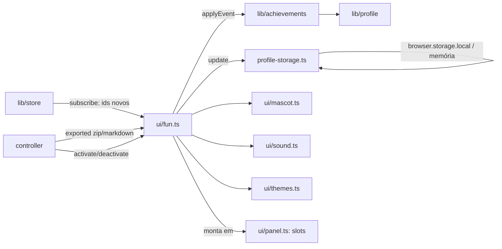

# Diversão — Design

**Spec**: `.specs/features/2026-11-14-diversao/spec.md`
**Status**: Pronto para Tasks (spec aprovada pelo dev em 2026-11-14; regra do andar: seguir sem parar para aprovar design/tasks).

---

## Visão geral



Um orquestrador só (`ui/fun.ts`) liga tudo. A lógica de XP, nível e conquistas é pura (`lib/`), o resto é UI fina. O controller ganha 4 linhas; o painel ganha dois pontos de inserção e um `expand()`.

## Decisões

| # | Decisão | Por quê |
|---|---|---|
| D1 | **Anotação nova** é detectada pelo `ui/fun.ts` assinando o `store` e comparando ids (id que não estava no conjunto conhecido = nova). Edição e exclusão não criam id novo, logo não dão XP (CONQ-01). | A spec pede ouvir o `store` em vez de mexer no controller. |
| D2 | **Export/cópia**: `exportZip` e `copyMarkdown` passam a devolver `Promise<boolean>` (sucesso). O controller chama `fun.exported('zip' \| 'markdown')` quando dá certo. | `markExported` não diferencia 2º export sem mudanças e "copiar markdown" não toca o store. Mudança de 2 `return` no `exporter.ts` + 2 linhas no controller. |
| D3 | **"Ainda não exportadas"** (CONQ-02): `ui/fun.ts` guarda o conjunto de ids já exportados nesta aba; N = ids da lista atual fora dele. Anotação excluída antes do export não conta. | Lógica fica fora do store (que é de outro domínio e dos outros andares). |
| D4 | **Curva de nível**: alcançar Nv n+1 exige `25·n·(n+1)` XP acumulado (= `50·n·(n+1)/2`). Nv 1 = 0 XP, Nv 2 = 50, Nv 3 = 150, Nv 4 = 300, Nv 5 = 500. `levelOf(xp)` devolve `{ level, into, span }` para a barra. | Exemplo da spec; 5 anotações já sobem um nível. |
| D5 | **Conquistas não dão XP.** | Spec não pede; evita inflar a curva. |
| D6 | **Contadores**: no Perfil (persistem) `stats.annotations`, `stats.mobile`, `stats.zips`; na aba (memória) `adds`, `categories`, `recent` (timestamps). Pixel Perfect, Speedrun e Maratona usam os da aba; Primeiro Pixel, Caçador Mobile e Quest Completa usam os do Perfil. | "Na mesma aba" vs "acumulado" conforme a spec. Maratona conta anotações **criadas** na aba (excluir não desconta). |
| D7 | **Persistência** (`profile-storage.ts`): chave `pxa:profile` em `browser.storage.local` (compartilhada entre origens e abas, CONQ-07). Toda mudança é `get → normalizar → aplicar → set`, serializada numa fila de promises por aba. `storage.onChanged` atualiza a visão das outras abas. | Duas abas ao mesmo tempo: a janela de corrida entre abas é o tempo de um `get/set` (ms); **aceitamos perda mínima** nesse caso (opção da spec), registrado no STATE. |
| D8 | **Sem storage** (API ausente ou erro): cai para um perfil em memória da aba; a UI é a mesma. | Caso limite "Q-01 negada". |
| D9 | **Perfil corrompido/antigo**: `normalizeProfile(raw)` valida campo a campo e substitui só o inválido pelo padrão; conquistas desconhecidas são descartadas. | Caso limite. |
| D10 | **Toasts de conquista** usam elemento próprio (`.pxa-trophy-toast`, acima do toast normal) com **fila**: um por vez, 2,5s cada. | Não apaga o "Zip exportado" e não quebra os locators `.pxa-toast` do E2E existente. |
| D11 | **Humor do Mascote**: transitório (`feliz` 1,5s, `susto` 1,5s, `festa` 2s) volta para `idle`. Evento novo substitui o anterior. Sono: com o modo ativo, `pointermove`/`pointerdown`/`keydown` em `window` (captura, `passive`) marcam a última interação; um intervalo de 1s põe em `dormindo` após 60s; a próxima interação volta a `idle`. | MASC-02..04. |
| D12 | **Animação** só em CSS (`@keyframes` com `steps()`), por classe `pxa-mood-<humor>` no mascote. `@media (prefers-reduced-motion: reduce)` zera a animação: o humor só troca o quadro (MASC-05). | Sem timers de animação em JS. |
| D13 | **Arte do Mascote (Q-02)**: o alfinete rosa do ícone (`scripts/gen-icons.mjs`) com olhos, 16×16, desenhado em 2× (32px). Um quadro por humor. `pixelIcon` ganha parâmetro opcional de paleta. Preview em `assets/mascot-preview.html` para o dev confirmar. | Padrão proposto na spec; confirmação fica como pendência do dev. |
| D14 | **Sons** (`ui/sound.ts`): `AudioContext` criado na primeira vez que toca (sempre após gesto do dev), osciladores `square`/`triangle`, ganho fixo 0,04. Sequências como dados: `blip` (~90ms), `fanfare` (~600ms), `jingle` (~720ms), todas ≤ 800ms. Qualquer exceção é engolida (SOM-04). Fanfarra só no `.zip`; copiar markdown faz festa sem som. | "Exporta" = `.zip` (leitura conservadora). |
| D15 | **Temas**: `ui/styles.ts` passa a usar custom properties (`--pxa-ink`, `--pxa-paper`, `--pxa-surface`, `--pxa-hover`, `--pxa-danger-hover`, `--pxa-accent`, `--pxa-on-accent`, `--pxa-muted`, `--pxa-rule`, `--pxa-head-bg`, `--pxa-head-fg`, `--pxa-scanlines`) com os valores do `Padrão` em `.pxa-layer`. `ui/themes.ts` define as 5 paletas e aplica com `layer.style.setProperty`. CRT usa `--pxa-scanlines` (gradiente repetido) no fundo do painel. Marcadores mantêm `CATEGORY_COLOR` e tinta fixa (TEMA-04). | Sem duplicar CSS (TEMA-03). |
| D16 | **Contraste (TEMA-05)**: teste unitário calcula a razão WCAG de cada par texto/fundo de cada tema (tinta/papel, tinta/superfície, tinta/hover, tinta/hover-perigo, sobre-acento/acento, apagado/papel, cabeçalho). O `Padrão` tinha texto branco sobre rosa no botão primário (3,36:1): passa a usar tinta escura (5,39:1). | Única mudança visual no tema atual; necessária para o requisito. |
| D17 | **Konami** (`lib/konami.ts`): matcher puro de sequência (`ArrowUp ArrowUp ArrowDown ArrowDown ArrowLeft ArrowRight ArrowLeft ArrowRight b a`, letras sem distinção de caixa). Listener em `window` na captura, `passive`, nunca chama `preventDefault`/`stopPropagation` (EGG-02). Ignora teclas cujo `composedPath` inclui o editor de nota (`.pxa-editor`). Só instalado com o modo ativo. Repetir o código depois de desbloqueado faz a dança de novo, sem toast. | EGG-01/02. |
| D18 | **Layout**: cabeçalho = `[mascote][título][Nv n + barra][🏆][export][recolher]`; o título ganha reticências se faltar espaço. Abaixo do cabeçalho, uma barra `.pxa-fun-bar` com seletor de tema e botão 🔈/🔇 (some com o painel recolhido). A visão Conquistas é um bloco próprio no painel; aberta, esconde lista e rodapé (classe `pxa-show-achievements`). Clicar 🏆 com o painel recolhido expande o painel. | MASC-01, CONQ-03/06, caso limite mobile. |

## Componentes

### `lib/profile.ts` (puro)

```ts
export const PROFILE_KEY = 'pxa:profile'
export type ThemeId = 'padrao' | 'gameboy' | 'nes' | 'crt' | 'noite'
export interface Profile {
  version: 1
  xp: number
  achievements: Partial<Record<AchievementId, string>> // id → ISO do desbloqueio
  stats: { annotations: number; mobile: number; zips: number }
  theme: ThemeId
  sound: boolean
}
export function defaultProfile(): Profile
export function normalizeProfile(raw: unknown): Profile
export function levelOf(xp: number): { level: number; into: number; span: number }
```

### `lib/achievements.ts` (puro)

```ts
export type AchievementId = 'primeiro-pixel' | 'cacador-mobile' | 'pixel-perfect' | 'speedrun' | 'quest-completa' | 'maratona' | 'codigo-secreto'
export interface Achievement { id; name; description; secret: boolean }
export const ACHIEVEMENTS: readonly Achievement[]
export interface TabStats { adds: number; categories: ScreenCategory[]; recent: number[] }
export type FunEvent =
  | { type: 'annotated'; category: ScreenCategory; at: number }
  | { type: 'exported'; fresh: number }   // só .zip
  | { type: 'konami' }
export function applyEvent(p: Profile, tab: TabStats, e: FunEvent, nowIso: string):
  { profile: Profile; tab: TabStats; xp: number; unlocked: AchievementId[] }
```

Regras: `annotated` → +10 XP, `stats.annotations++`, `mobile++` se mobile; aba: `adds++`, categoria, `recent` filtrado a 60s. `exported` → +5·fresh XP, `zips++`. Depois avalia todas as condições e desbloqueia as que ainda não estão no perfil.

### `lib/konami.ts` (puro)

`createKonami(): (key: string) => boolean` — devolve `true` no último passo da sequência; tecla errada reinicia (considerando que ela pode ser o 1º passo).

### `lib/contrast.ts` (puro)

`contrastRatio(a: string, b: string): number` (WCAG 2.x, hex `#rrggbb`).

### `entrypoints/annotator.content/profile-storage.ts`

```ts
export interface ProfileStorage {
  load(): Promise<Profile>
  update(fn: (p: Profile) => Profile): Promise<Profile>  // serializado
  onChange(cb: (p: Profile) => void): () => void         // mudanças de outras abas
}
export function createProfileStorage(area = browser.storage?.local): ProfileStorage
```

### `ui/mascot.ts`

`MASCOT: Record<Mood, readonly string[]>` (16×16, paleta própria) e `createMascot()` → `{ el, mood(), set(mood, ms?) }`. `el` é um `span.pxa-mascot` com o SVG (`pixelIcon(grid, 2, MASCOT_PALETTE)`), `data-mood` e classe `pxa-mood-<mood>`.

### `ui/sound.ts`

`SOUNDS: Record<SoundName, Note[]>` (`{ freq, ms, wave }`), `soundDuration(name)`, `createSound(factory?)` → `{ play(name) }`. Fábrica injetável para teste.

### `ui/themes.ts`

`THEMES: readonly { id, label, vars }[]` e `applyTheme(layer, id)`.

### `ui/fun.ts` (orquestrador)

```ts
export function createFun(ui: UiHost, store: AnnotationStore, mount: PanelMount, deps?: { storage?, sound?, now? }) => {
  activate(): () => void          // listeners de interação/Konami + timer de sono
  exported(kind: 'zip' | 'markdown'): void
}
```

Monta no cabeçalho (mascote, `Nv`, 🏆), na barra (tema, som) e a visão Conquistas; carrega o perfil e aplica tema/som; trata a fila de toasts de conquista.

### Mudanças em arquivos existentes (mínimas)

| Arquivo | Mudança |
|---|---|
| `ui/panel.ts` | `headStart` (antes do título) e `headEnd` (antes do export) como slots; devolve `mount: { panel, headStart, headEnd }` e `expand()`. |
| `ui/styles.ts` | Cores → custom properties; regras novas do mascote, `Nv`, barra, conquistas, toast de conquista, `prefers-reduced-motion`. |
| `ui/icons.ts` | `pixelIcon(rows, scale, palette = PALETTE)`; ícone `TROPHY` e ícones de conquista. |
| `controller.ts` | Cria `fun`; `fun.activate()` no teardown do `activate`; `exported()` após export/cópia com sucesso. |
| `exporter.ts` | `exportZip`/`copyMarkdown` devolvem `boolean`. |
| `wxt.config.ts`, `scripts/check-manifest.mjs` | `storage` nas permissões (Q-01). |

## Testes

| Requisito | Onde |
|---|---|
| CONQ-01..05, CONQ-07 (normalização) | `tests/unit/achievements.test.ts`, `profile.test.ts` |
| CONQ-07 persistência/abas, D7/D8 | `tests/unit/profile-storage.test.ts` (fakeBrowser) + E2E reload |
| MASC-01..06, CONQ-03/04/06, SOM-01, TEMA-02 | `tests/unit/fun.test.ts`, `mascot.test.ts` (happy-dom) |
| SOM-02..04 | `tests/unit/sound.test.ts` (AudioContext falso) |
| TEMA-01/03/04/05 | `tests/unit/themes.test.ts` |
| EGG-01/02 | `tests/unit/konami.test.ts`, `fun.test.ts` |
| Integração (CSP, persistência entre recarregamentos, reduced motion, Konami) | `tests/e2e/fun.spec.ts` |
| PLAT-01 atualizado | `check:manifest` |

## Riscos

- `ui/styles.ts` muda em muitas linhas (cores → variáveis): conflito certo com os outros andares que mexerem nele. Mitigação: os seletores não mudam, só os valores; quem fizer merge troca hex por `var(--pxa-…)`.
- `storage.onChanged` no Firefox MV3: mesma API; verificação manual pendente com o dev.

---

## Revisão 1 (2026-11-14, feedback do dev)

Remoções valem por cima das decisões acima: D3, D4, D5, D6, D10 e D16 (só o par de silhueta) saem com as conquistas.

| # | Decisão |
|---|---|
| R1 | **Sem XP/nível/conquistas:** apagar `lib/achievements.ts`, `ui/achievement-icons.ts`, o `Nv`, o 🏆, a visão Conquistas e o toast de conquista (CSS e o parâmetro `className` do `showToast` voltam ao original). `exported()` só faz festa (+ fanfarra no `.zip`). |
| R2 | **Perfil = `{ version, theme, sound }`.** `normalizeProfile` ignora campos de versões antigas (`xp`, `achievements`, `stats`) e tema desconhecido (`crt`, `nes`, `gameboy`) cai para `padrao`. `profile-storage.ts` não muda. |
| R3 | **Temas:** só `padrao` e `noite`. Saem as variáveis `--pxa-scanlines` e `--pxa-silhouette` (só serviam ao CRT e às conquistas); o painel volta a `background: var(--pxa-paper)`. |
| R4 | **Mascote (MASC-06/07):** grades novas (alfinete fofo sem boca; feliz = olhos `^^`, susto = gota de suor, festa = confete, dormindo = olhos fechados + `z`). Paleta por tema em `MASCOT_PALETTES: Record<ThemeId, …>`; `createMascot(theme)` monta os 5 quadros da paleta e `mascot.setTheme(id)` remonta. `fun.ts` chama `setTheme` junto com `applyTheme`. O `z` usa cor clara própria para aparecer no cabeçalho escuro. |
| R5 | **Ícone de som (SOM-01):** `SPEAKER_ON`/`SPEAKER_OFF` 12×12 em `ui/icons.ts` (alto-falante com ondas / com X), no botão via `pixelIcon`; `aria-label` continua "Ligar som"/"Desligar som". |
| R6 | **Konami (EGG-01):** só `mascot.set('festa')` + jingle; `lib/konami.ts` fica. |

## Revisão 2 (2026-11-14, feedback do dev)

| # | Decisão |
|---|---|
| R2-1 | **Paleta única:** `MASCOT_PALETTES` por tema volta a ser `MASCOT_PALETTE` (K `#1a1226`, P `#ff3e7f`, W, G, Y, B, Z `#ffffff`). Saem `setTheme`, o cache por tema e a chamada em `fun.ts`. R4 da Revisão 1 fica sem efeito na parte de cor. |
| R2-2 | **Arte:** cabeça 10×8 (era 12×9), olhos de 1×2 px nas colunas 6 e 9, longe do contorno (no cabeçalho escuro o contorno some e olho colado na borda vira listra); sem bochecha (`R` sai). Feliz/festa = olhos em traço; susto = olhos de 3 px + gota; dormindo = traço baixo + `z` 4×4 desenhado com diagonal (o 3×3 parecia um `I`). |
