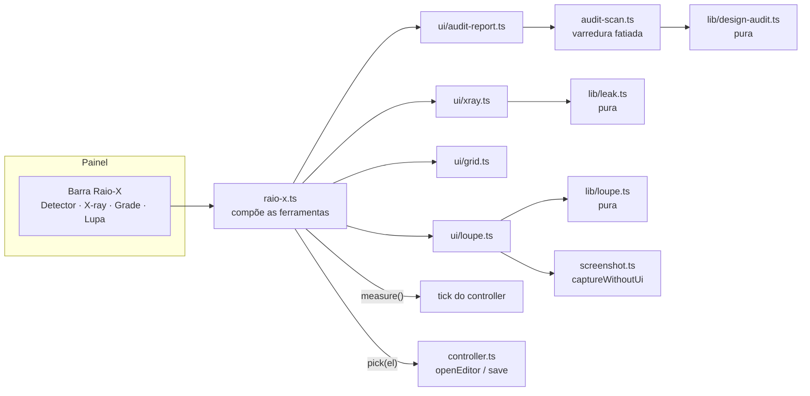

# Raio-X — Design

**Spec**: `.specs/features/2026-11-14-raio-x/spec.md` (21 requisitos: DETE-01..07, XRAY-01..06, GRAD-01..03, LUPA-01..04)
**Contexto**: `.specs/features/2026-11-14-raio-x/context.md`
**Status**: Approved — 2026-11-14 (spec aprovada pelo dev; agente do andar segue sem parar para aprovação de design, por instrução do dev)

---

## Visão Geral

Tudo roda no **annotator** (isolated world). Nenhuma mudança no background, no probe ou no manifest: a Lupa usa a mesma mensagem `pxa:capture` e a mesma fila (≥ 550ms) do print do M1.



| Módulo | Novo/alterado | Responsabilidade |
|---|---|---|
| `lib/design-audit.ts` | novo | Normalizar cor, distância de cor, escala, órfãos, montar o relatório e o texto da nota (DETE-02/03/05/07) |
| `lib/leak.ts` | novo | Regra de vazamento (filho fora do pai, conteúdo maior que a caixa) e seletor curto (XRAY-02/04) |
| `lib/loupe.ts` | novo | Mapeia cursor CSS → pixel físico e amostra a janela 15×15 do print (LUPA-01/04) |
| `annotator.content/audit-scan.ts` | novo | Varredura dos elementos visíveis em lotes de 500 com `requestIdleCallback`, limite 10.000 (DETE-01/06) |
| `annotator.content/raio-x.ts` | novo | Barra de ferramentas, estado ligado/desligado de cada ferramenta, `measure()` para o tick, `pick()` para o clique |
| `annotator.content/ui/boxes.ts` | novo | Pool de caixas `position: fixed` desenhadas por diferença (usado pelo X-ray e pelo destaque do relatório) |
| `annotator.content/ui/audit-report.ts` | novo | Janela do relatório, hover destaca, botão "Anotar" (DETE-02/04/05) |
| `annotator.content/ui/xray.ts` | novo | Contornos por profundidade + vazamentos em vermelho (XRAY-01..06) |
| `annotator.content/ui/grid.ts` | novo | Grade em `repeating-linear-gradient` (GRAD-01..03) |
| `annotator.content/ui/loupe.ts` | novo | Lupa: print congelado, zoom 8×, hex, copiar, Esc (LUPA-01..04) |
| `annotator.content/screenshot.ts` | alterado (pequeno) | Extrai `captureWithoutUi(ui, capture)` (esconder UI → 2 frames → foto → mostrar) e `withShotBitmap(dataUrl, fn)`, reusados pela Lupa |
| `annotator.content/page.ts`, `lib/color.ts` | novos (/simplify) | Walker da página + visibilidade + pular `display:none` (Detector e X-ray); `toHex` único |
| `annotator.content/controller.ts` | alterado (pequeno) | Cria o Raio-X, inclui `raioX.measure()` no tick, consulta `raioX.pick()` no clique, `annotateElements()` reusa `openEditor` + `save` |
| `annotator.content/ui/panel.ts` | alterado (pequeno) | Parâmetro opcional `toolbar` inserido logo abaixo do `<header>` (ponto único) |
| `annotator.content/ui/styles.ts` | alterado (append) | Bloco CSS `/* Raio-X */` no fim, com as cores atuais |

### Abordagem escolhida e alternativas descartadas

| Tema | Escolhido | Descartado | Por quê |
|---|---|---|---|
| Onde mostrar o relatório | Janela flutuante própria (`.pxa-audit`) à esquerda, com fechar | Dentro do `<ol>` do Painel | Não mexe na lista de anotações (outros andares mexem no Painel). O Painel ganha só a barra. |
| Unidade de "usado N×" | Nº de **elementos** distintos que usam o valor | Nº de propriedades | "Anotar" age sobre elementos; um botão com `color` e `border-color` iguais conta 1. |
| Cores "parecidas" | Agrupamento por semente: cores ordenadas por uso; cada cor entra no grupo da primeira semente a ΔE76 ≤ 5 (Lab) | Union-find (ligação simples) | Ligação simples encadeia degradês inteiros num grupo só. Com semente, a nota fica clara: "parecida com `#777777` (mais usada)". |
| Limiar de cor | ΔE76 ≤ 5 e cores diferentes | Distância RGB euclidiana | Lab segue a percepção; ΔE ≈ 2,3 é o limiar perceptível, 5 pega "quase iguais" sem juntar tons claramente distintos. |
| Transparência | Só compara cores com o **mesmo alfa** (opacas com opacas) | Compor sobre branco | Spec: não comparar translúcidas com opacas. Mesmo alfa é o caso conservador. |
| Achado | Cada linha do relatório com pelo menos uma marca (fora da escala, parecida, órfã) é um Achado com botão "Anotar"; a nota junta os motivos | Um achado por motivo | Uma linha = um valor = um conjunto de elementos; evita anotações duplicadas do mesmo elemento. |
| Atualizar X-ray | Recalcula só com flag "sujo" (scroll em captura, resize, ou a cada 500ms) e desenha por diferença | Recalcular todo frame | Ler o retângulo de 3.000 elementos todo frame é caro; scroll/resize/timer pegam rolagem, redimensionamento e mudanças de layout. |
| Vazamento por `position: fixed` | Ignorado | Contar | O bloco de contenção de `fixed` é o viewport, não o pai: seria sempre falso positivo (cabeçalhos fixos, toasts). |
| Captura da Lupa | `captureWithoutUi` extraído de `screenshot.ts` | Copiar as 5 linhas na Lupa | Mesmo comportamento do print (UI escondida, 2 frames). Mudança pequena num arquivo que os outros andares não tocam. |
| GRAD-03 | Grade vive no host do PxA: `ui.setHidden(true)` do print já esconde | Esconder à mão | `visibility: hidden` herda; nada a fazer além de testar. |

---

## Componentes

### `lib/design-audit.ts` (pura — DETE-07)

```ts
export interface AuditSample {           // um elemento visível, estilos computados crus
  colors: string[]                       // color, background-color, border-{top,right,bottom,left}-color
  fontSize: string; fontFamily: string; fontWeight: string
  spacings: string[]                     // margin-*, padding-*, row-gap, column-gap
}
export type Flag = 'off-scale' | 'similar' | 'orphan'
export interface AuditEntry { value: string; count: number; elements: number[]; flags: Flag[]; similarTo?: string }
export interface AuditReport {
  scale: 4 | 8
  colors: AuditEntry[]; fonts: AuditEntry[]; spacings: AuditEntry[]
  fontSizes: number                      // tamanhos distintos (cabeçalho)
  offScale: number                       // espaçamentos distintos fora da escala (cabeçalho)
}
export function normalizeColor(css: string): string | null   // rgb()/rgba()/hex → #rrggbb | #rrggbbaa; transparente → null
export function colorDistance(a: string, b: string): number  // ΔE76 em Lab
export function parsePx(v: string): number | null           // 'auto'/'normal'/não-px → null; negativo → absoluto
export function isOnScale(px: number, scale: number): boolean // tolerância 0,01px (rem/zoom)
export function buildAuditReport(samples: AuditSample[], scale: 4 | 8): AuditReport
export function auditHeadline(r: AuditReport): string        // "23 cores · 11 tamanhos de fonte · 3 espaçamentos fora da escala de 4px"
export function findingNote(kind: 'color'|'font'|'spacing', e: AuditEntry, scale: number): string
// ex: "[Raio-X] espaçamento 13px fora da escala de 4px (3 elementos)"
//     "[Raio-X] cor #7a7a7a parecida com #777777 (2 elementos)"
//     "[Raio-X] fonte 13px Arial 400 órfã: usada 1× (1 elemento)"
```

- Valores de fonte: chave `"<size>px <primeira família> <peso>"` (família sem aspas; a lista inteira fica no `title`).
- Espaçamento `0px` conta (está na escala). Órfão = `count ≤ 2`.
- Ordenação de cada seção: com marca primeiro, depois por `count` decrescente.

### `audit-scan.ts` (DETE-01/06)

```ts
export interface ScanResult { elements: Element[]; samples: AuditSample[]; truncated: boolean; ms: number }
export async function scanDocument(opts?: { batch?: number; limit?: number; onProgress?(done: number): void; idle?: (cb: () => void) => void }): Promise<ScanResult>
```

- Percorre `document.body` com `TreeWalker` (pula a subárvore com `data-pxa-ignore`).
- Visível = retângulo com largura e altura > 0, e `visibility` diferente de `hidden`/`collapse` (`display:none` dá retângulo zero, inclusive nos descendentes).
- Lotes de 500 com `requestIdleCallback(cb, { timeout: 50 })` (cai para `setTimeout(0)` sem rIC). Para em 10.000 elementos visíveis com `truncated: true` (aviso no relatório).

### `ui/audit-report.ts` (DETE-02/04/05)

Janela `.pxa-audit` (fixa, à esquerda, `max-height` com rolagem):
- Cabeçalho com `auditHeadline` + botão fechar.
- Linha de controles: "Escala: 4px/8px" (alterna e recalcula a partir das amostras, sem varrer de novo) e "Varrer de novo".
- Avisos: "Cortado em 10.000 elementos" (DETE-06), "A página mudou. Varra de novo." (SPA: o `href` mudou desde a varredura).
- Três seções (`Cores`, `Fontes`, `Espaçamentos`), cada linha: amostra de cor (só cores), valor, `N×`, etiquetas (`fora da escala`, `parecida com #…`, `órfã`) e "Anotar" se tiver etiqueta.
- `mouseenter` na linha → `highlight(elements)`; `mouseleave` → limpa. O destaque é desenhado no `measure()` via `ui/boxes.ts` (acompanha a rolagem), até 300 caixas.
- "Anotar" → `actions.annotate(elements, findingNote(...))`.

### `ui/xray.ts` + `lib/leak.ts` (XRAY-01..06)

```ts
// lib/leak.ts
export interface Box { left: number; top: number; right: number; bottom: number }
export function overflowOutside(child: Box, parent: Box, clipX: boolean, clipY: boolean): number // px além de 1px, 0 se não vaza
export function contentOverflow(scrollW: number, clientW: number, scrollH: number, clientH: number, visibleX: boolean, visibleY: boolean): number
export function clips(overflow: string): boolean                 // hidden | clip | auto | scroll
export function shortSelector(el: Element): string               // #id | tag.classe (sem classes geradas) | tag
export function leakNote(kind: 'parent' | 'content', sel: string, px: number): string
// "[Raio-X] vaza do pai div.card em 12px" | "[Raio-X] conteúdo vaza de div.card em 12px"
```

- `measure()`: se ligado e "sujo", lista os elementos visíveis que cruzam o viewport (mesma regra de visibilidade da varredura), profundidade a partir do `<body>`, cor `depth % 6` da paleta pixel. Vazamento:
  1. filho fora do retângulo do pai (primeiro ancestral com caixa > 0) em mais de 1px num eixo que o pai **não** corta; ignora `position: fixed`;
  2. `scrollWidth > clientWidth` (ou altura) com `overflow` visível no eixo (ignora `html` e `body`, que rolam o viewport).
- Mais de 1.500 elementos no viewport → desenha só os vazamentos e mostra aviso na barra (XRAY-06).
- `pickLeak(el)`: sobe de `el` até achar um elemento marcado → `{ target, note }` (XRAY-04). Clique fora de vermelho segue o fluxo normal (XRAY-05).

### `ui/grid.ts` (GRAD-01..03)

Uma `div.pxa-grid` fixa em tela cheia, `pointer-events: none`, com dois `repeating-linear-gradient` (colunas a cada 8 ou 4px em rosa translúcido; linha de base a cada 4px em azul translúcido). `measure()` ajusta `background-position` para `-scrollX -scrollY` (alinhada ao topo do documento). O botão alterna `desligada → 8px → 4px → desligada`.

### `ui/loupe.ts` + `lib/loupe.ts` (LUPA-01..04)

```ts
// lib/loupe.ts
export interface Pixels { width: number; height: number; data: Uint8ClampedArray }
export function physicalPoint(cssX: number, cssY: number, img: { width: number; height: number }, vw: number, vh: number): { x: number; y: number } // escala = img/viewport (DPR + zoom)
export function sampleWindow(px: Pixels, cx: number, cy: number, size = 15): Array<string | null>   // hex por pixel, null fora do print
export const toHex: (r: number, g: number, b: number) => string
```

- Ligar → `captureWithoutUi` → `createImageBitmap` → canvas → `ImageData` guardado.
- `pointermove` (captura, passivo) guarda o cursor; `measure()` redesenha o canvas 120×120 (15×15 pixels × 8) com grade, pixel central marcado e hex, perto do cursor (vira para o outro lado na borda).
- `scroll`/`resize` → print inválido, mostra "atualizando…", novo pedido 300ms depois de parar; contador de geração descarta respostas velhas. A fila do background garante ≥ 550ms.
- Clique (via `pick`) → `navigator.clipboard.writeText(hex)` + toast "#rrggbb copiado"; não cria Anotação. `Esc` (keydown em captura) desliga.
- Falha na captura → toast "Print indisponível nesta página" (mesmo termo do M1: "Print: indisponível") e a Lupa desliga.

### `raio-x.ts` (composição)

```ts
export interface RaioXActions {
  annotate(elements: Element[], note: string): void   // controller.annotateElements
}
export function createRaioX(ui: UiHost, actions: RaioXActions, deps?: { capture?: CaptureTab; scan?: typeof scanDocument }) {
  return {
    toolbar: HTMLElement,           // barra inserida no Painel
    measure(): () => void,          // leituras de todas as ferramentas; devolve as escritas
    pick(el: Element): { handled: true } | { target: Element; note: string } | null,
    reset(): void,                  // desliga tudo (desativar o modo)
  }
}
```

### Mudanças no `controller.ts`

```ts
const raioX = createRaioX(ui, { annotate: annotateElements })
const panel = createPanel(ui, store, actions, raioX.toolbar)
// onPick:
const rx = raioX.pick(el)
if (rx && 'handled' in rx) return
const target = rx?.target ?? el
openEditor(target.getBoundingClientRect(), rx?.note, (note) => void save(target, note))
// tick: [overlay.measure(), markers.measure(), raioX.measure()]
// deactivate: raioX.reset()

/** Genérico: uma nota editável, um print por alvo. A regra do DETE-05 (pular sumidos e avisar,
 *  máx. 5 alvos, senão só o primeiro) fica em raio-x.ts (`annotateFinding`), fora do controller. */
function annotateElements(targets: Element[], note: string) {
  if (state !== 'active' || !targets[0]) return
  targets[0].scrollIntoView({ block: 'center', inline: 'nearest' })
  overlay.highlight(targets[0])
  openEditor(targets[0].getBoundingClientRect(), note, async (final) => {
    for (const t of targets) { if (state === 'inactive') break; if (t.isConnected) await save(t, final) }
  })
}
```

---

## Tratamento de Erros

| Cenário | Comportamento |
|---|---|
| Elemento do Achado sumiu antes de "Anotar" | Pula e avisa "N elemento(s) sumiram da página"; nenhum vivo → só o aviso |
| Varredura > 10.000 elementos | Para e mostra "Cortado em 10.000 elementos" |
| Rota SPA mudou com relatório aberto | Aviso "A página mudou. Varra de novo." |
| Lupa em página sem captura | Toast "Print indisponível nesta página" e desliga |
| Clipboard indisponível | Toast "Não consegui copiar #rrggbb" |
| X-ray com > 1.500 elementos no viewport | Só vazamentos + aviso na barra |

## Riscos

| Risco | Mitigação |
|---|---|
| Conflito de merge no Painel/estilos/controller com os andares Diversão e Equipe | Inserções em pontos únicos; CSS num bloco no fim de `styles.ts`; cores literais atuais (Diversão converte depois) |
| Custo do X-ray em páginas grandes | Flag de sujo + desenho por diferença + corte em 1.500 |
| Lupa pisca a UI a cada novo print | Mesmo comportamento do print do M1; só após 300ms parado |
| Firefox: `requestIdleCallback`, `createImageBitmap`, clipboard | APIs existem no Firefox; verificação manual listada para o dev |

## Testes

| Camada | Teste |
|---|---|
| `lib/design-audit.ts`, `lib/leak.ts`, `lib/loupe.ts` | unit puro (Vitest), nomes com o ID |
| `audit-scan.ts`, `ui/*` novos, `raio-x.ts`, `controller.ts` | unit no happy-dom com `createHost()` (retângulos simulados com `vi.spyOn(Element.prototype, 'getBoundingClientRect')` quando preciso) |
| Integração | E2E `tests/e2e/raio-x.spec.ts` com a fixture `raio-x.html`: 3 espaçamentos fora da escala, 2 cores quase iguais, 1 filho vazando (critério de sucesso); Anotar cria anotação; X-ray marca o vazamento e o clique abre a nota; Grade some no print; Lupa copia hex |
