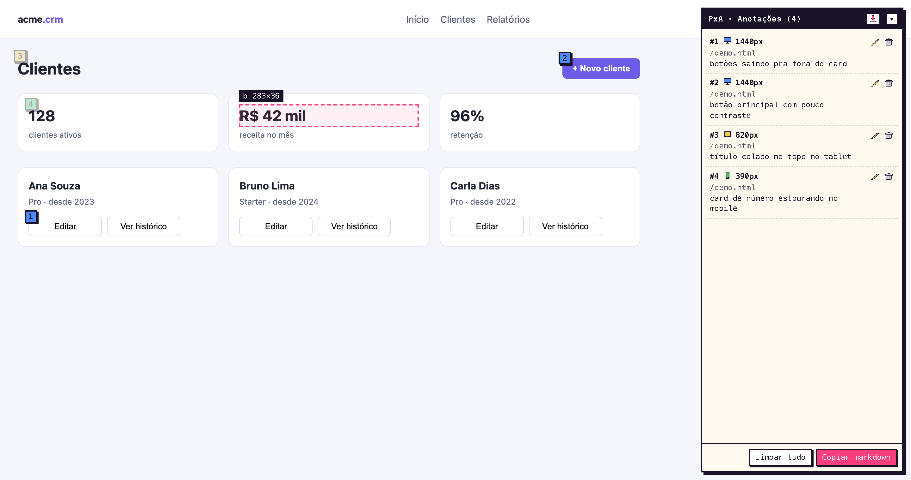

<p align="center">
  
</p>

<h1 align="center">PixelAnnotator (PxA)</h1>

<p align="center">
  Aponte, anote e mande pro Claude Code: feedback visual em lote, com tela, componente e print de cada ajuste
</p>

<p align="center">
  
  
  
  <a href="https://github.com/giovannifranco1/plugin-pixel-annotator/releases/latest"></a>
  
  
</p>

<p align="center">
  
</p>

<p align="center"><sub>Anotações feitas em 1440px 🖥️, 820px 📟 e 390px 📱. Vistos no desktop, os marcadores do tablet e do mobile aparecem esmaecidos.</sub></p>

> [!NOTE]
> Pedir ajuste visual pro Claude costuma virar "esse botão aqui, nessa tela, quebrando no celular". O PxA resolve isso na própria página: você clica nos elementos, escreve o que precisa mudar, e cada anotação já leva o **seletor**, o **componente React/Vue**, a **largura da tela em px** (📱 mobile, 📟 tablet, 🖥️ desktop) e um **print recortado**. No fim, um `.zip` ou um markdown compacto vai direto pro Claude Code.

---

## Instalação

O PxA ainda não está nas lojas, mas instala em dois minutos, sem precisar de nada além do navegador.

| Navegador | Download |
|---|---|
| Chrome, Edge, Brave, Arc | [**pixel-annotator-chrome.zip**](https://github.com/giovannifranco1/plugin-pixel-annotator/releases/latest/download/pixel-annotator-chrome.zip) |
| Firefox 128 ou mais novo | [**pixel-annotator-firefox.zip**](https://github.com/giovannifranco1/plugin-pixel-annotator/releases/latest/download/pixel-annotator-firefox.zip) |

Os links baixam sempre a versão mais recente. As anteriores ficam na página de [Releases](https://github.com/giovannifranco1/plugin-pixel-annotator/releases).

Se o link der erro 404, a release com os zips ainda não foi publicada. Enquanto isso, gere o build pelos passos de [Para desenvolvedores](#para-desenvolvedores).

### Chrome, Edge, Brave e Arc

1. Baixe o `pixel-annotator-chrome.zip` e **descompacte** (duplo clique no arquivo).
2. Mova a pasta `pixel-annotator-chrome` para um lugar fixo, como Documentos. O navegador lê a extensão dessa pasta: se ela for apagada, o PxA some.
3. Abra a página de extensões digitando na barra de endereço:
   - Chrome e Arc: `chrome://extensions`
   - Edge: `edge://extensions`
   - Brave: `brave://extensions`
4. Ligue o **Modo do desenvolvedor** (no canto superior direito; no Edge, fica na barra lateral).
5. Clique em **Carregar sem compactação** e escolha a pasta `pixel-annotator-chrome`.
6. Clique no ícone de quebra-cabeça 🧩 da barra e fixe o PxA 📌.

### Firefox

1. Baixe o `pixel-annotator-firefox.zip`. Não precisa descompactar.
2. Digite `about:debugging#/runtime/this-firefox` na barra de endereço.
3. Clique em **Carregar extensão temporária…** e escolha o `pixel-annotator-firefox.zip`.
4. Clique no ícone de quebra-cabeça 🧩 da barra e fixe o PxA 📌.

> [!IMPORTANT]
> No Firefox, a extensão carregada assim some quando o navegador fecha. Para usar de novo, repita os passos 2 e 3.

### Atualizar para uma versão nova

- **Chrome e derivados:** baixe e descompacte o zip novo, substitua o conteúdo da pasta `pixel-annotator-chrome` e clique em ↻ no card do PxA em `chrome://extensions`.
- **Firefox:** carregue o zip novo como no passo 3.

### Para desenvolvedores

Para gerar o build a partir do código, é preciso ter Node 22 ou mais novo:

```bash
npm install
npm run build          # Chrome → .output/chrome-mv3
npm run build:firefox  # Firefox → .output/firefox-mv3
npm run zip            # zip do Chrome → .output/
npm run zip:firefox    # zip do Firefox → .output/
```

Carregue `.output/chrome-mv3` ou `.output/firefox-mv3/manifest.json` como nos passos acima. Depois de mudar o código, rode o build de novo e recarregue a extensão.

As releases saem sozinhas: o workflow `.github/workflows/release.yml` roda a cada tag de versão (criada pelo `git flow release finish`), gera os dois zips e anexa na release do GitHub. Para uma tag que já existe, rode o workflow **Release** pela aba Actions informando a tag.

## Como usar

1. Abra a página que quer ajustar (o seu `localhost` ou qualquer site) e **clique no ícone do PxA**. O painel aparece e o modo anotação liga.
2. Passe o mouse: o elemento sob o cursor fica destacado com a tag e o tamanho (`button 120×40`).
3. **Clique no elemento**, escreva o que precisa mudar e aperte **Enter**. Shift+Enter quebra a linha e Esc cancela. O clique não dispara nada da página: nenhum link navega e nenhum botão é acionado.

   

4. Repita em quantos elementos quiser, inclusive em outras larguras. Abra o modo responsivo do DevTools (`Cmd+Shift+M` / `Ctrl+Shift+M`) e cada anotação guarda a largura em que foi feita.
5. Exporte:
   - **Copiar markdown:** o resumo compacto vai para a área de transferência. É só colar no Claude Code.
   - **Exportar .zip** (menu de ações ⋮ no cabeçalho do painel): `feedback.md` completo com os prints em `shots/` e o `pxa.json`, que outro PxA consegue importar. Descompacte na pasta do projeto e peça *"resolve o feedback.md"*.
6. Clique no ícone de novo para sair. As anotações ficam guardadas enquanto a aba estiver aberta.

### Raio-X: achar o que o olho não vê

O **Raio-X** são as duas primeiras opções do menu de ações (⋮, no cabeçalho do painel). Ferramenta ligada aparece com ✓ no menu e com um ponto rosa no ⋮. Nenhuma altera a página: tudo é desenhado por cima, na UI do PxA.

- **Detector:** varre a página e lista as **cores**, os **tamanhos de fonte**, as **famílias** e os **espaçamentos** em uso, com quantos elementos usam cada um (ex: `23 cores · 11 tamanhos de fonte · 2 famílias · 3 espaçamentos fora da escala de 4px`). Os Achados aparecem primeiro; o resto fica recolhido. Ele acusa:
  - espaçamento fora da escala de 4px (ou 8px no botão **Escala**). Os meios passos do Tailwind (2, 6, 10 e 14px) são aceitos;
  - cor ou tamanho de fonte **quase igual** a um valor bem mais usado, e raro: `#7a7a7a` perto de `#777777`, `13px` perto de `14px`;
  - **fonte padrão do navegador** em poucos elementos numa página que usa outra fonte: o clássico `button`/`input` sem `font: inherit`.

  Entende cores modernas (`oklch()`, `lab()`, `color()` do Tailwind 4), junta cores que diferem só no arredondamento (ninguém vê a diferença) e ignora `0`, `auto`, percentuais, `sr-only` e o interior de SVGs. O cabeçalho começa pelo número de Achados; seção sem problema mostra **tudo certo**, e cada Achado diz a referência e o que usar. Se o relatório tampar o que você quer ver, arraste-o pelo cabeçalho (ou use as setas). Passe o mouse num valor para destacar onde ele está, clique no valor para rolar até o próximo elemento e clique em **Anotar** para virar anotação com a nota pronta para o Claude Code, ex: `[Raio-X] espaçamento 13px (padding) fora da escala de 4px: usar 12px ou 14px (3 elementos)`.
- **Lupa:** zoom 8× dos pixels sob o cursor, com a cor em hex. Clique para copiar o hex e aperte Esc para sair.

## Recursos

- **Marcadores numerados** sobre cada elemento anotado, na cor da tela em que você anotou: verde no mobile, amarelo no tablet e azul no desktop. Quando a largura atual é de outra categoria, o marcador fica esmaecido.
- **Contexto capturado em cada anotação:**
  - URL e rota
  - seletor CSS único, que ignora classes geradas por CSS-in-JS e CSS modules
  - largura e altura do viewport, breakpoint Tailwind (`base sm md lg xl 2xl`), DPR e orientação
  - CSS relevante, só o que difere do padrão do navegador
  - HTML do elemento
  - print recortado com o elemento contornado
- **Componente React e Vue:** nome do componente e cadeia de pais (`ClienteCard ← ClienteList ← Dashboard`). O arquivo de origem aparece quando o framework o expõe: Vue 2/3 e React até a versão 18 em dev.
- **Painel estilo quest log:** clique num item para rolar até o elemento, e use o ⋮ de cada item para **Editar**, **Desenhar no print** ou **Excluir**. A numeração nunca é reaproveitada.
- **Pensado para o mobile:** abaixo de 768px o painel se recolhe numa barra com o contador, para não cobrir a página. O ícone de exportar continua à mão.

  

- **Funciona em SPA:** ao trocar de rota sem reload, os marcadores mostram só as anotações da rota atual e o painel mantém todas.
- **UI isolada:** tudo roda em Shadow DOM, acima de qualquer `z-index`. O CSS da página não afeta o PxA e o CSS do PxA não afeta a página.
- **Diversão (tudo opcional, nada bloqueia o fluxo):**
  - **Mascote:** um alfinete pixel no cabeçalho do painel que fica feliz quando você anota, leva susto em anotação mobile, faz festa ao exportar e dorme depois de 60s parado. Com *reduzir movimento* ligado no sistema, ele só troca de quadro.
  - **Sons 8-bit:** desligados por padrão; ligue no alto-falante do painel. Gerados na hora com Web Audio, sem arquivos.
  - **Temas:** Padrão (claro, rosa) e Noite (escuro), no seletor do painel. As cores dos marcadores (mobile/tablet/desktop) não mudam.
  - **Segredo:** com o modo ligado, tente o Konami code. 🎮
- **Nada se perde no refresh:** as anotações (com os prints) ficam salvas no próprio site. Recarregue, navegue ou feche o navegador: ao clicar no ícone de novo, tudo volta. Elas só saem com **Limpar tudo** ou excluindo uma a uma.
- **Erros do console junto da nota:** ao clicar para anotar, o PxA pega os erros de console e as falhas de rede do último minuto (`console.error`, exceções, promises rejeitadas, `fetch`/XHR com status ≥ 400 ou sem resposta). O editor mostra a lista e você remove o que não tem a ver antes de salvar. No painel o item ganha o selo `⚠ N`.
- **Desenho no print:** **Desenhar no print**, no ⋮ do item, abre o print num editor com pincel, seta, círculo e X, em rosa, amarelo ou ciano. Ctrl/Cmd+Z desfaz e Esc fecha sem salvar. O traço é pixelado, em blocos de 2px.

## Em equipe

- **Apresentar:** o item do menu de ações (⋮) passa pelas anotações uma a uma, como slides, numa call de revisão. A página escurece em volta do elemento e um cartão mostra a nota. Use → ou Espaço para avançar, ← para voltar, Home/End para ir à primeira/última e Esc para sair. Anotações de outra rota aparecem com o print e a rota; se a largura da tela for de outra categoria, o cartão avisa (*anotada em 📱 390px, você está em 🖥️ 1440px*).
- **Importar .zip** (menu de ações ⋮): abra o `.zip` que um colega exportou e os marcadores dele aparecem na sua página. As anotações importadas ganham números novos e guardam o original (`#3 de staging.app.com`). Se o `.zip` veio de outro site, o PxA avisa e importa mesmo assim. Importar o mesmo arquivo de novo não duplica nada. Elemento que o seletor não acha fica marcado como *elemento não encontrado* no painel, sem marcador. Só exports feitos a partir desta versão (com `pxa.json`) podem ser importados.

## O que o Claude Code recebe

**Copiar markdown:** 2 linhas por ajuste.

```markdown
# PxA · localhost:3000 · 2 ajustes visuais

- **#1** botões saindo pra fora do card
  📱 390px `base` · `/dashboard?tab=2` · `ClienteCard` `src/components/ClienteCard.tsx:42` · `[data-testid="cliente-card"] > div.card-footer`
- **#2** padding maior em cima
  🖥️ 1440px `xl` · `/dashboard` · `h1.page-title`
```

**Exportar .zip:** `pxa-feedback-AAAA-MM-DD-HHmm.zip`, com um `feedback.md` completo, os prints em `shots/01.png`, `shots/02.png`, … e o `pxa.json` (os mesmos dados para máquina, com versão de esquema, usado pelo Importar). Anotação com desenho leva o print desenhado em `shots/NN.png` e o original em `shots/NN-original.png`.

````markdown
## #1 · 📱 mobile · 390px (`base`) · `/dashboard?tab=2`

- **Componente:** `ClienteCard` ← `ClientesList` ← `DashboardPage` (React)
- **Seletor:** `[data-testid="cliente-card"] > div.card-footer`
- **Viewport:** 390×844 · DPR 3 · retrato
- **Print:** 

**Nota:**

```text
botões saindo pra fora do card
```

**CSS relevante:**

```css
display: flex;
width: 420px;
gap: 16px;
padding: 8px;
```
````

Com erros anexados, a anotação ganha uma seção **Erros no console** e o markdown compacto ganha `⚠ N erros` na linha de metadados:

````markdown
**Erros no console:**

```text
14:30:05 console.error: TypeError: cliente is undefined ×3
14:30:08 rede: GET http://localhost:3000/api/clientes → 404
```
````

## Permissões e privacidade

- Pede só **`activeTab`**, **`scripting`** e **`storage`**. O PxA não lê nenhum site até você clicar no ícone naquela aba. O `storage` guarda só o tema e o som que você escolheu, no próprio navegador, e não gera aviso na instalação.
- Nada sai do seu navegador. Não há servidor, conta nem telemetria. O `.zip` é baixado direto e o markdown vai só para a sua área de transferência.
- As anotações ficam salvas no **IndexedDB do próprio site** (banco `pxa-annotator`), no seu navegador. Por ser da origem do site, o JavaScript dele consegue ler esse banco: evite anotar dado sensível em site de terceiros. Se o navegador bloquear o IndexedDB, o PxA volta a guardar só na memória da aba e avisa antes de sair.
- Em páginas onde extensões não podem rodar (`chrome://`, lojas de extensão, visualizador de PDF), o ícone mostra um **!**.
- **Erros do console:** o registro começa quando você clica no ícone, não antes. Guarda no máximo 50 erros e, da rede, só método, URL e status, **nunca** corpo nem headers. A URL perde a query string e o fragmento, mas tokens que estejam **no caminho** da URL continuam lá: revise a lista no editor antes de salvar. Se a página bloquear o script (CSP, página especial), a anotação sai sem erros.
- **Importar** lê o `.zip` no próprio navegador, com limite de 50 MB no arquivo e 100 MB descompactados.

## Como funciona

São três partes, todas injetadas sob demanda quando você clica no ícone:

- **Background:** liga e desliga o modo e tira o print da aba (`tabs.captureVisibleTab`). As capturas entram numa fila, por causa do limite do navegador.
- **Annotator** (content script, isolated world): a UI em Shadow DOM, o estado das anotações, a captura de contexto, o recorte do print e o export (com [fflate](https://github.com/101arrowz/fflate)).
- **Probe** (main world): lê os internals do React (`__reactFiber$…`) e do Vue (`__vueParentComponent`, `__vue__`) que o content script não enxerga, e responde por `CustomEvent`. Se não houver framework ou a leitura falhar em 300ms, a anotação sai sem componente. Ele também envolve `console.error`, `fetch` e `XMLHttpRequest` (sempre chamando o que já estava lá, como Sentry) para o registro de erros.

Feito com [WXT](https://wxt.dev) e TypeScript, sem framework de UI.

## Desenvolvimento

```bash
npm run dev              # Chrome com recarga automática
npm run dev:firefox      # Firefox com recarga automática
npm test                 # testes unitários (Vitest)
npm run test:e2e         # E2E no Chromium com a extensão carregada (Playwright)
npm run compile          # checagem de tipos
npm run check:manifest   # confere que os builds pedem só activeTab + scripting + storage
npm run screenshots      # regenera os prints deste README (media/)
npm run icons            # regenera os ícones pixel art
```

A lógica pura fica em `lib/`, com testes em `tests/unit/`. A extensão fica em `entrypoints/` e os testes E2E e as páginas de teste em `tests/e2e/`. As specs que guiaram o projeto (spec, design, tasks e decisões) estão em `.specs/`.

## Roadmap

- **M1 — Modo Anotação** ✅ (este README)
- **Raio-X** ✅: Detector de design system e Lupa pixel
- **Equipe e Claude** ✅: apresentação, desenho no print, importar sessão e erros do console
- **M2 — Ponte com o Claude Code:** servidor MCP local para o Claude Code ler as anotações sem download

## Licença

[MIT](LICENSE)
