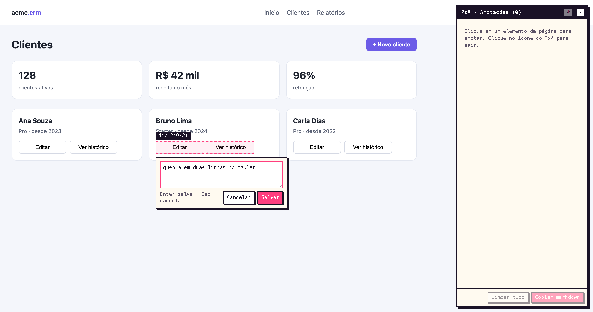
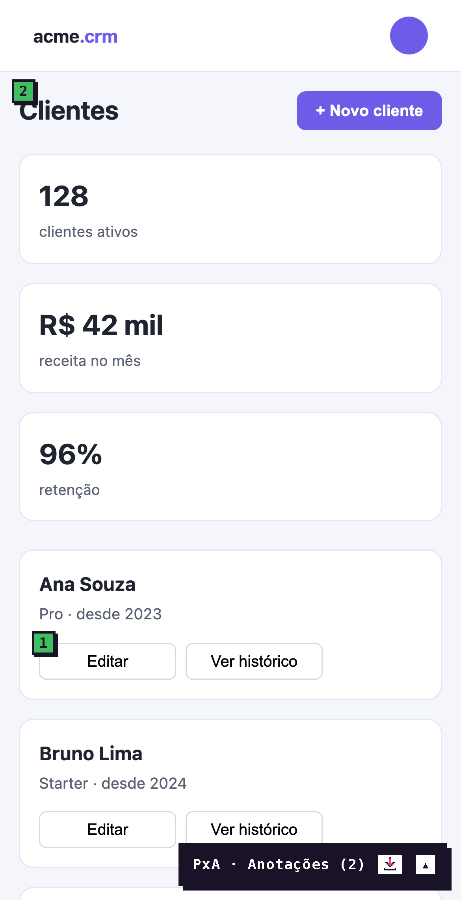

<p align="center">
  
</p>

<h1 align="center">PixelAnnotator (PxA)</h1>

<p align="center">
  Aponte, anote e mande pro Claude Code: feedback visual em lote, com tela, componente e print de cada ajuste
</p>

<p align="center">
  
  
  
  
  
  
</p>

<p align="center">
  
</p>

<p align="center"><sub>Anotações feitas em 1440px 🖥️, 820px 📟 e 390px 📱. Vistos no desktop, os marcadores do tablet e do mobile aparecem esmaecidos.</sub></p>

> [!NOTE]
> Pedir ajuste visual pro Claude costuma virar "esse botão aqui, nessa tela, quebrando no celular". O PxA resolve isso na própria página: você clica nos elementos, escreve o que precisa mudar, e cada anotação já leva o **seletor**, o **componente React/Vue**, a **largura da tela em px** (📱 mobile, 📟 tablet, 🖥️ desktop) e um **print recortado**. No fim, um `.zip` ou um markdown compacto vai direto pro Claude Code.

---

## Instalação

O PxA ainda não está nas lojas. Para instalar, gere o build e carregue a extensão em modo desenvolvedor. É preciso ter Node 22 ou mais novo.

```bash
npm install
npm run build          # Chrome → .output/chrome-mv3
npm run build:firefox  # Firefox → .output/firefox-mv3
```

### Chrome

1. Abra `chrome://extensions` e ligue o **Modo do desenvolvedor**, no canto superior direito.
2. Clique em **Carregar sem compactação** e escolha a pasta `.output/chrome-mv3`.
3. Fixe o ícone do PxA na barra pelo ícone de quebra-cabeça.

### Firefox (128 ou mais novo)

1. Abra `about:debugging#/runtime/this-firefox`.
2. Clique em **Carregar extensão temporária…** e escolha o **arquivo** `.output/firefox-mv3/manifest.json`.
3. Fixe o ícone do PxA na barra.

A extensão temporária do Firefox some quando o navegador fecha. É só carregar de novo.

**Atualizar depois de mudar o código:** rode o build de novo e clique em ↻ (Chrome) ou em **Recarregar** (Firefox) no card da extensão.

## Como usar

1. Abra a página que quer ajustar (o seu `localhost` ou qualquer site) e **clique no ícone do PxA**. O painel aparece e o modo anotação liga.
2. Passe o mouse: o elemento sob o cursor fica destacado com a tag e o tamanho (`button 120×40`).
3. **Clique no elemento**, escreva o que precisa mudar e aperte **Enter**. Shift+Enter quebra a linha e Esc cancela. O clique não dispara nada da página: nenhum link navega e nenhum botão é acionado.

   

4. Repita em quantos elementos quiser, inclusive em outras larguras. Abra o modo responsivo do DevTools (`Cmd+Shift+M` / `Ctrl+Shift+M`) e cada anotação guarda a largura em que foi feita.
5. Exporte:
   - **Copiar markdown:** o resumo compacto vai para a área de transferência. É só colar no Claude Code.
   - **Exportar .zip** (ícone ⤓ no cabeçalho do painel): `feedback.md` completo com os prints em `shots/`. Descompacte na pasta do projeto e peça *"resolve o feedback.md"*.
6. Clique no ícone de novo para sair. As anotações ficam guardadas enquanto a aba estiver aberta.

## Recursos

- **Marcadores numerados** sobre cada elemento anotado, na cor da tela em que você anotou: verde no mobile, amarelo no tablet e azul no desktop. Quando a largura atual é de outra categoria, o marcador fica esmaecido.
- **Contexto capturado em cada anotação:**
  - URL e rota
  - seletor CSS único, que ignora classes geradas por CSS-in-JS e CSS modules
  - largura e altura do viewport, breakpoint Tailwind (`base sm md lg xl 2xl`), DPR e orientação
  - CSS relevante, só o que difere do padrão do navegador
  - HTML do elemento
  - print recortado com o elemento contornado
- **Componente React e Vue:** nome do componente e cadeia de pais (`ClienteCard ← ClienteList ← Dashboard`). O arquivo de origem aparece quando o framework o expõe: Vue 2/3 e React até a versão 18 em dev.
- **Painel estilo quest log:** clique num item para rolar até o elemento, edite ou exclua com os ícones ✎ e 🗑. A numeração nunca é reaproveitada.
- **Pensado para o mobile:** abaixo de 768px o painel se recolhe numa barra com o contador, para não cobrir a página. O ícone de exportar continua à mão.

  

- **Funciona em SPA:** ao trocar de rota sem reload, os marcadores mostram só as anotações da rota atual e o painel mantém todas.
- **UI isolada:** tudo roda em Shadow DOM, acima de qualquer `z-index`. O CSS da página não afeta o PxA e o CSS do PxA não afeta a página.
- **Diversão (tudo opcional, nada bloqueia o fluxo):**
  - **Mascote:** um alfinete pixel no cabeçalho do painel que fica feliz quando você anota, leva susto em anotação mobile, faz festa ao exportar e dorme depois de 60s parado. Com *reduzir movimento* ligado no sistema, ele só troca de quadro.
  - **XP, nível e conquistas:** 10 XP por anotação, 5 XP por anotação que vai num `.zip`, `Nv n` com barra no cabeçalho. O ícone 🏆 abre a lista das 7 conquistas (há uma secreta).
  - **Sons 8-bit:** desligados por padrão; ligue no 🔇 do painel. Gerados na hora com Web Audio, sem arquivos.
  - **Temas:** Padrão, Game Boy, NES, CRT e Noite, no seletor do painel. As cores dos marcadores (mobile/tablet/desktop) não mudam.
- **Aviso antes de perder:** com anotações que ainda não foram para um `.zip`, recarregar ou fechar a aba mostra o aviso de saída do navegador.

## O que o Claude Code recebe

**Copiar markdown:** 2 linhas por ajuste.

```markdown
# PxA · localhost:3000 · 2 ajustes visuais

- **#1** botões saindo pra fora do card
  📱 390px `base` · `/dashboard?tab=2` · `ClienteCard` `src/components/ClienteCard.tsx:42` · `[data-testid="cliente-card"] > div.card-footer`
- **#2** padding maior em cima
  🖥️ 1440px `xl` · `/dashboard` · `h1.page-title`
```

**Exportar .zip:** `pxa-feedback-AAAA-MM-DD-HHmm.zip`, com um `feedback.md` completo e os prints em `shots/01.png`, `shots/02.png`, ….

````markdown
## #1 · 📱 mobile · 390px (`base`) · `/dashboard?tab=2`

- **Componente:** `ClienteCard` ← `ClientesList` ← `DashboardPage` (React)
- **Seletor:** `[data-testid="cliente-card"] > div.card-footer`
- **Viewport:** 390×844 · DPR 3 · retrato
- **Print:** 

**Nota:**

```text
botões saindo pra fora do card
```

**CSS relevante:**

```css
display: flex;
width: 420px;
gap: 16px;
padding: 8px;
```
````

## Permissões e privacidade

- Pede só **`activeTab`**, **`scripting`** e **`storage`**. O PxA não lê nenhum site até você clicar no ícone naquela aba. O `storage` guarda só o seu perfil da Diversão (XP, conquistas, tema e som), no próprio navegador, e não gera aviso na instalação.
- Nada sai do seu navegador. Não há servidor, conta nem telemetria. O `.zip` é baixado direto e o markdown vai só para a sua área de transferência.
- As anotações vivem **só na memória da aba**: recarregar a página apaga tudo. A persistência por site está planejada para o M2.
- Em páginas onde extensões não podem rodar (`chrome://`, lojas de extensão, visualizador de PDF), o ícone mostra um **!**.

## Como funciona

São três partes, todas injetadas sob demanda quando você clica no ícone:

- **Background:** liga e desliga o modo e tira o print da aba (`tabs.captureVisibleTab`). As capturas entram numa fila, por causa do limite do navegador.
- **Annotator** (content script, isolated world): a UI em Shadow DOM, o estado das anotações, a captura de contexto, o recorte do print e o export (com [fflate](https://github.com/101arrowz/fflate)).
- **Probe** (main world): lê os internals do React (`__reactFiber$…`) e do Vue (`__vueParentComponent`, `__vue__`) que o content script não enxerga, e responde por `CustomEvent`. Se não houver framework ou a leitura falhar em 300ms, a anotação sai sem componente.

Feito com [WXT](https://wxt.dev) e TypeScript, sem framework de UI.

## Desenvolvimento

```bash
npm run dev              # Chrome com recarga automática
npm run dev:firefox      # Firefox com recarga automática
npm test                 # testes unitários (Vitest)
npm run test:e2e         # E2E no Chromium com a extensão carregada (Playwright)
npm run compile          # checagem de tipos
npm run check:manifest   # confere que os builds pedem só activeTab + scripting + storage
npm run screenshots      # regenera os prints deste README (media/)
npm run icons            # regenera os ícones pixel art
```

A lógica pura fica em `lib/`, com testes em `tests/unit/`. A extensão fica em `entrypoints/` e os testes E2E e as páginas de teste em `tests/e2e/`. As specs que guiaram o projeto (spec, design, tasks e decisões) estão em `.specs/`.

## Roadmap

- **M1 — Modo Anotação** ✅ (este README)
- **M2 — Ponte com o Claude Code:** servidor MCP local para o Claude Code ler as anotações sem download, e persistência por site

## Licença

[MIT](LICENSE)
